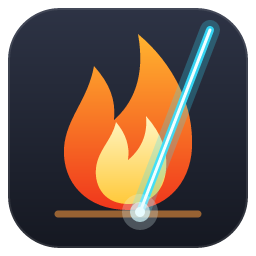
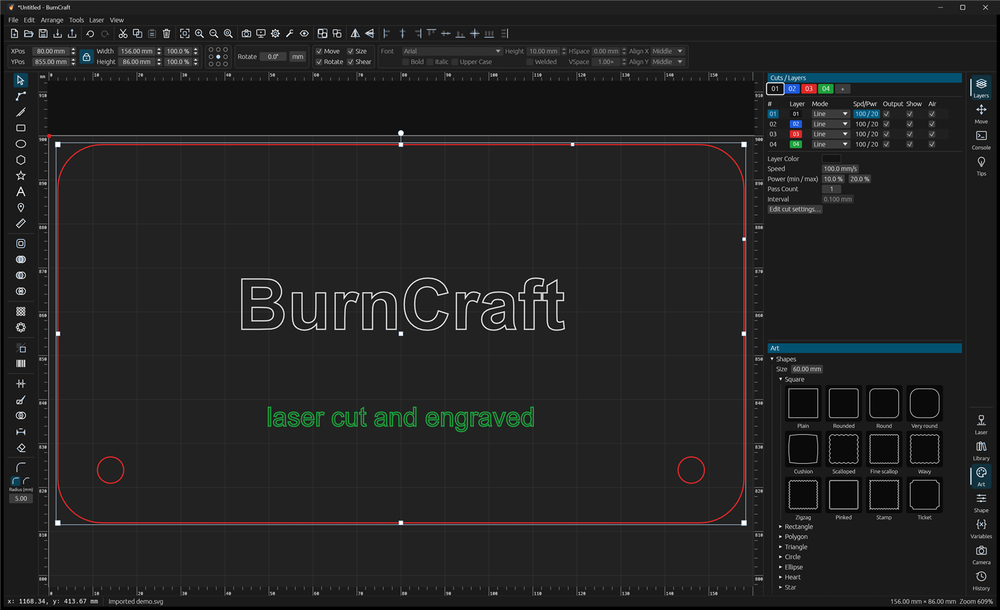

<p align="center">
  
</p>

<h1 align="center">BurnCraft</h1>

<p align="center">
  <b>Design, prepare and run jobs on laser cutters and engravers. Free, fast, and written in Rust.</b>
</p>

<p align="center">
  
  
  
  
</p>



BurnCraft is a desktop app for laser cutters and engravers. It covers the whole workflow in one window: draw or import a design, assign cut, fill and image settings by layer, preview the toolpath with a time estimate, then frame and run the job on the machine.

It drives **Ruida** DSP controllers (most CO2 lasers), **G-code** machines (GRBL, Marlin, Smoothieware, plus diode lasers like the LaserPecker LP2 Plus) and **galvo** fiber/UV/CO2 markers. It also opens **LightBurn** project files and device profiles, so you can bring your existing work with you.

> [!WARNING]
> BurnCraft is in early development. Ruida over Ethernet has been run on real hardware (RDC6445G). The other drivers are tested against simulated controllers only. Lasers are dangerous: always supervise a running job, keep the lid closed, and keep a fire extinguisher nearby. See [Safety](#safety).

> [!TIP]
> **New to BurnCraft?** The [Help guide](../../wiki) explains every feature step by step, from adding your laser to running your first job.

---

## Contents

- [Highlights](#highlights)
- [Supported lasers](#supported-lasers)
- [Features](#features)
- [Help](#help)
- [Getting started](#getting-started)
- [Connecting your laser](#connecting-your-laser)
- [Keyboard shortcuts](#keyboard-shortcuts)
- [Project structure](#project-structure)
- [Development](#development)
- [Roadmap](#roadmap)
- [Safety](#safety)
- [Acknowledgements](#acknowledgements)
- [License](#license)

---

## Highlights

- **A full design environment:** shapes, paths, node editing, text in any installed font, booleans, offsets, arrays, nesting, alignment, barcodes and QR codes, image tracing.
- **Layer-based cut settings:** Line, Fill, Fill + Line and Image modes with speed, power, passes, intervals, dithering, kerf, tabs, lead-ins, overscan and cross-hatching.
- **Several controller families:** Ruida (Ethernet/USB), GRBL / Marlin / Smoothieware / custom G-code (USB serial), BJJCZ galvo boards (USB) and the LaserPecker 2 (USB).
- **Machine profiles:** keep a list of lasers, switch between them, import LightBurn `.lbdev` device files and `.lbzip` exports (for example the ones LaserPecker publishes), and export your machines to BurnCraft `.bcdev` files to move them to another computer.
- **Opens LightBurn files:** `.lbrn2` / `.lbrn` projects open with their layers, shapes, groups, images and editable text.
- **Accurate preview:** see every burn, overscan and travel move with a scrubber and a time estimate before you fire the laser.
- **Variable text:** serial numbers, dates and CSV merge for batches of tags, labels and name plates.
- **Camera overlay:** line up designs on the material using a webcam over the bed.
- **Box generator:** finger-jointed boxes and living hinges, sized by inside or outside dimensions, with kerf compensation.
- **Rotary support:** engrave around tumblers, glasses and other cylinders with a roller or chuck.
- **Remote monitoring:** watch progress, time left and the camera from your phone, and pause or stop the job.
- **Fast and self-contained:** a single native executable with no runtime to install.

## Supported lasers

| Controller | Connection | Typical machines | Status |
|---|---|---|---|
| **Ruida** RDC644x / 654x (incl. RDC6445G), RDC634XG, RDL9635 | Ethernet (UDP) or USB | Most CO2 laser cutters | ✅ Ethernet tested on hardware · USB untested |
| **GRBL** 1.1 (M4 dynamic or M3 constant power) | USB serial | Diode lasers, hobby CNC lasers, LaserPecker LP2 Plus | ⚠️ Untested on hardware |
| **Marlin** (laser feature) | USB serial | 3D-printer-based lasers | ⚠️ Untested on hardware |
| **Smoothieware** | USB serial | K40 upgrades, Smoothieboard machines | ⚠️ Untested on hardware |
| **Custom G-code** | USB serial | Anything that takes G-code, with your own commands | ⚠️ Untested on hardware |
| **BJJCZ / LMC galvo** (EZCad2 boards) | USB | Fiber, UV and CO2 galvo markers | ⚠️ Untested on hardware |
| **LaserPecker 2** (its own USB protocol) | USB serial (CH340) | LaserPecker LP2 | ⚠️ Untested on hardware |

If you run BurnCraft on any of the untested controllers, a report of how it went (good or bad) is very welcome. Please [open an issue](../../issues).

## Features

### Design

- **Canvas:** work-area bed with grid and rulers on all four sides, in millimetres or inches. Mouse-wheel zoom, middle/right-drag pan, zoom to fit (Ctrl+0) or to the selection (Ctrl+2). Optional Y-up coordinates.
- **Drawing tools:** Select, Edit Nodes, Line/Path, Rectangle (with corner radius), Ellipse, Polygon, Star, Text, Measure, and Position Laser (click to move the head). Hold Shift for squares and circles.
- **Corner, Trim, Knife and Dimension tools:**
  - **Corner:** click corners to round or chamfer each one with its own size. Rounded corners can be changed again, and size 0 makes them sharp.
  - **Trim:** delete a piece of outline back to the lines crossing it.
  - **Knife:** drag a line to split shapes in two.
  - **Dimension:** drag to place a labelled measurement on a tool layer, so it's never cut.
- **Guides:**
  - **Smart guides:** shapes snap into line with other shapes' edges and centres, the bed and ruler guides while you drag.
  - **Ruler guides:** drag them out of the rulers, and drag them back to remove.
- **Selection and transforms:**
  - Click, Shift+click or drag a box to select. Drag to move.
  - Corner handles resize: proportional by default, Ctrl to stretch.
  - A rotate handle (Shift for 15° steps) and shear.
  - Exact X / Y / width / height with an aspect lock, rotate by any angle, mirror.
  - Arrow keys nudge 1 mm (Shift = 10 mm, Ctrl = 0.1 mm). Lock objects against moving, resizing or rotating.
- **Snapping:** to the grid and to other shapes' points, corners and centres.
- **Node editing:** drag points and Bézier handles, double-click an edge to add a point, delete points, round corners.
- **Warp:** Arch, Bulge, Taper / perspective, Wave, Bridge, Flag, Barrel, Tuna can, Title crawl, Rays and 3D rotate, with a live preview.
- **Live effects** (Shape tab): Offset, Round corners, Warp, Simplify and Smooth kept on a shape without changing it, adjustable, reorderable and removable at any time, then applied when final.
- **Simplify / Smooth:** fewer points and smooth curves for traced or imported art.
- **Copy Along Path:** repeat objects evenly around or along a shape, optionally rotated to follow it.
- **Arrange:**
  - Align (left / centre / right / top / middle / bottom), distribute, dock.
  - Make same width/height, draw order (to front/back, forward/backward), move to bed centre.
  - Grid and circular arrays.
  - Nesting: **true-shape** (parts tuck into each other's curves and notches, and small parts go inside holes; rotation in 90°, 45° or 15° steps) or fast bounding-box rows.
  - **Place on Each Slot** (batch engraving on a jig): draw slot outlines and use **Mark as Jig Slots**, or let the camera find the items on the bed. The design is copied onto every slot, centred and turned to match, and can be scaled to fit.
  - **Fit Into Box:** scale a design to fit inside a shape, centred.
  - **Split into Tiles:** cut a design bigger than the bed into a grid of tiles joined by dovetails or puzzle knobs, pulled apart and grouped so each can be cut on its own.
- **Parametric design** (Arrange → Parameters & Constraints):
  - Named parameters such as `thickness = 3`, which can be formulas using earlier ones (`slot = thickness + 0.2`).
  - Lock a shape's width or height (choosing which edge stays put), or the distance across or down between two shapes.
  - Values can be numbers or formulas. Change a parameter and everything that uses it updates; move a shape and the shapes locked to it follow.
  - Constraints show on the canvas as blue dimensions (View → Show Constraints).
- **Path tools:** weld/union, subtract, intersect, offset inward or outward, break apart, auto-join, close paths, reverse direction, delete duplicates, convert to path. Select open shapes, select the current layer, or invert the selection.
- **Text:**
  - Any installed font, with bold, italic and multi-line text.
  - Left/centre/right alignment, letter and line spacing, upper case.
  - Weld overlapping letters into one outline for script fonts.
  - Pair kerning (widen or tighten the gap between any two letters), a grid of every character the font has, and splitting text into one editable text per letter.
  - **BurnCraft Single Line**, a built-in stroke font: letters are drawn as single lines rather than outlines, so text engraves in one quick pass (even on a Fill layer).
  - **Monogram** maker: a large surname initial between two smaller ones, with an optional circle, ring or diamond frame.
- **Barcodes:** QR codes (optionally with an empty square in the middle for a logo, using the strongest error correction so they still scan) and Code 128.
- **Makers** (Tools → Makers):
  - Finger-jointed boxes, closed or open-top, sized by inside or outside dimensions.
  - Any material thickness and finger width; every edge gets a whole, odd number of fingers.
  - Kerf compensation so joints fit snugly.
  - Living-hinge patterns with adjustable cut length, bridge and spacing.
  - Jigsaw puzzles: any size and number of pieces, knob size, rounded corners, and a new random cut with one click.
  - Involute spur gears from a tooth count and module, with a bore and keyway, optionally as a meshing pair (centre distance shown).
  - Signs and plaques: rectangle, rounded, oval or plaque shape, an engraved border, text that shrinks to fit, mounting holes, and an optional edge-lit acrylic base.
  - Packaging: tuck-end boxes, pillow boxes and envelopes, with the fold lines on a low-power Score layer.
- **Variable text:** `{serial}`, `{serial:0000}`, `{date}`, `{time}`, `{row}` and CSV columns such as `{Name}` in text and barcodes. It can auto-advance after each job.
- **Images:** brightness, contrast, gamma, invert, auto levels, sharpen and background removal; Sketch, Line Art and Edges effects turn photos into drawings; **Burn Preview** shows images dithered as the laser will burn them. Importing a picture asks how it'll be used (engrave it, engrave and cut round it, or cut its outline), with one-click background removal and a preview of the cut line. Trace a bitmap into smooth vector curves (corners kept sharp), or into single-stroke **centre lines** for line art; trace dark areas (with an automatic threshold) or an object on a plain background. **PixScan** places a photo of an item at true size using a printed marker sheet. Crop or clip an image to any shape. An **eraser** rubs out parts of a picture right on the canvas, by brush or by clicking a colour (a background, say) to clear it.
- **Photo to Lines:** redraw a photo as one spiral, rows of waves or stippled dots, as vectors that burn fast (also on galvos).
- **Shadow box:** split a picture into 2–8 stacked plates by brightness.
- **Shop tools:**
  - **Stencil bridges:** the middles of letters like O, A and B stay attached when cut from a sheet.
  - **Inlay:** a pocket and a matching insert, both adjusted for kerf, with optional clearance and a mirrored insert.
  - **Rubber stamp:** mirrors and inverts the design, adds a half-power shoulder around it and a cut line.
  - **Contour cut line:** an outline around shapes, text or images at any distance, for stickers, magnets and badges.
  - **Rhinestone templates:** holes along the outline, in two rows, or filled in a honeycomb.
  - **Lattice** (a grid of holes with solid bars), **knockout** (a recess for pieces to drop into), **hatch fill**, **pierce points** for thick material, and **shadow / 3D** (drop shadow, cast shadow, extrude).
- **Symmetry drawing** (View → Symmetry): shapes you draw are mirrored left–right, top–bottom or four ways, or repeated around a centre like a mandala, with a live preview.
- **Text on a curve:** arc text over or under a circle, or put text along any shape.
- **Art tab:**
  - Ready-made blanks: coasters, ornament, keychain, dog tag, luggage tag, bookmark, name plate.
  - A shape library of over 100 shapes in ten groups (squares, rectangles, polygons, triangles, circles, ellipses, hearts, stars, arrows and more), many with scalloped, wavy, zigzag, pinked or stamp edges.
  - 18 repeating borders sized to any length and height.
  - Product templates (T-shirt, bodysuit, mug wrap, tote, card, cushion) on a tool layer, to size a design on.
- **Curve-preserving booleans:** Weld, Subtract and Intersect keep curves as curves, so results are smooth and light.
- **Shape Builder:** click or drag across the areas where shapes overlap to merge them (Alt: delete them).
- **More live effects:** Radial repeat (petals and rosettes, optionally welded), Envelope (bend by a grid of handles), Blend (morph one shape into another in steps) and Clip to a shape; slow effects are worked out in the background so the window never freezes.
- **More imports:** EPS and PostScript (a built-in PostScript interpreter), legacy PostScript `.ai`, Windows metafiles (EMF / WMF) and Photoshop documents (PSD / PSB, the flattened picture).
  - A browsable, searchable folder of your own SVG, DXF, LightBurn and image files, with previews.
- **Editing:** cut, copy, paste at the cursor, paste in place, duplicate, group/ungroup, and full undo/redo with a clickable history list.

### Layers and cut settings

- **Up to 255 colour layers.** Dimensions, jig slots and detected items go on hidden tool layers that are never sent to the laser, even in imported projects.
- **Modes:**
  - **Line:** cut or score along outlines. Holes are cut before outer shapes, and parts are ordered nearest-next.
  - **Fill:** raster-fill closed shapes (holes stay empty), at any scan angle, with optional cross-hatching. **Offset fill** instead traces rings inward from the outline, which is much faster for thin text and outlines.
  - **Fill + Line:** engrave the inside, then cut the outline.
  - **Image:** raster-engrave photos with Threshold, Ordered, Floyd–Steinberg, Atkinson, Jarvis or Stucki dithering, or Grayscale (power follows darkness on G-code machines).
- **Per-layer settings:** speed, min/max power, passes, line interval, scan both ways, overscan, air assist, output on/off, visibility, pulse frequency for galvos, and perforation (dashed cutting: cut length and gap).
- **Advanced settings:** kerf compensation, tabs/bridges (count, width, skip holes) and lead-ins that start in the scrap.
- **Cut library:** save layer settings by name and apply them to any layer.
- **Test patterns:** a speed × power grid, line-interval squares, a focus ramp (find the focus height on a tilted board) and a kerf strip (cut, push together, measure).

### Preview and running jobs

- **Preview** (Alt+P): every burn, overscan and travel move drawn on the bed, with a progress scrubber and an estimated job time.
- **Realistic preview:** the job burned into birch plywood, walnut, slate, black anodised or acrylic, clear acrylic, leather or cardboard. Darkness follows each layer's power, speed and passes.
- **Frame** the job's outline with the laser off. On machines that support it, you can also frame with the laser on at very low power. Galvos frame with the red pointer.
- **Start, Pause, Resume, Stop**, with a progress bar while the job is sent or run.
- **Cut selected graphics only,** or the whole design.
- **Run in Sections** (Laser menu): for designs taller than the bed on lasers with a pass-through slot. Each band is moved to the top of the bed and run on its own, with optional registration crosses to line up the material after feeding it forward.
- **Move tab:** live head position, jog buttons, jog distance and speed, go to X/Y, home, go to origin, unlock (GRBL).
- **Console** (G-code machines): send raw commands and see the replies.
- **Production queue**: several designs, each with a number of copies, burned one after another.
- **Machine Settings** (GRBL): read the controller's `$$` settings with descriptions, edit them, write back only what changed, and export or import them as a file.
- **Macros:** one-click buttons that send your own G-code, for example LaserPecker's red-dot and electric-stand commands.
- **Rotary** (Laser → Rotary Setup, Ctrl+Shift+R):
  - Roller or chuck rotaries that replace the Y axis; jobs and framing are scaled so the design wraps the object at true size.
  - A-axis output for 4-axis GRBL boards.
  - "Rotate once" for calibration, plus a warning when a design is taller than the object's circumference.
  - Not available for galvos yet.
- **Remote monitoring** (Settings → Remote monitoring): a page for any phone or computer on your network.
  - Shows the machine, job progress, elapsed and remaining time, position and the live camera.
  - Pause, Resume and Stop buttons.
  - PIN-protected, and off by default.
  - The page vibrates and beeps when a job finishes.

### Machine profiles

- **Device list:** keep any number of machines and switch between them from the Laser panel. Each remembers its controller, connection, work area, origin corner, speeds and macros.
- **Import LightBurn device files** (`.lbdev`, `.lbzip`): the work area, origin, baud rate, port, full-power S value, start/end G-code, M7 air assist, DTR, home-on-connect and macros all carry over.
- **Export and import BurnCraft device files** (`.bcdev`): one machine or the whole list, with every setting, to move to another computer or keep as a backup.
- **G-code options:** start/end G-code added to every job, M7 instead of M8 for air assist, DTR on or off, home on connect.

### Files

**Your work is safe:**
- Unsaved changes are backed up every minute; after a crash, BurnCraft offers to restore them.
- Saves are atomic, so a crash mid-save never corrupts a project.
- Closing with unsaved changes asks first.
- **File → Open Recent** lists your last 10 projects.

| Format | Open / import | Save / export |
|---|---|---|
| BurnCraft project (`.bcproj`, JSON with embedded images) | ✅ | ✅ |
| LightBurn project (`.lbrn2`, `.lbrn`) | ✅ Layers, shapes, groups, paths, images, editable text | - |
| LightBurn device (`.lbdev`) | ✅ As machine profiles | - |
| SVG | ✅ Colours map to layers; text becomes outlines | ✅ |
| DXF | ✅ Lines, polylines with arcs, circles, arcs, ellipses, splines; units honoured | ✅ Polylines in mm, one DXF layer per BurnCraft layer, in its colour |
| PDF | ✅ Vector paths from the first page (colours pick layers); text and images are reported, not imported | - |
| Adobe Illustrator (`.ai`, CS and later) | ✅ Same as PDF | - |
| PNG, JPG, BMP, GIF, TIFF, TGA, WebP | ✅ | - |
| G-code (`.gcode`, `.nc`, `.gc`) | ✅ Laser-on moves as lines; one layer per power | ✅ For G-code machines |
| HPGL (`.hpgl`, `.plt`) | ✅ Pen-down lines; one layer per pen | - |
| Ruida job (`.rd`) | ✅ Cut lines per layer | - |

You can also drag files onto the window to import them.

### Camera

- Live webcam overlay on the bed, for placing designs on the material.
- Four-point alignment: mark a target with the laser, then click its corners.
- **Detect items:** finds the items laid on the bed (lighter or darker than it, at any angle) and outlines each as a slot for Place on Each Slot.

## Help

The [BurnCraft wiki](../../wiki) is the full user guide:

- [Getting Started](../../wiki/Getting-Started): install, add your laser and run a first job
- [The Workspace](../../wiki/The-Workspace): every menu, tool and panel
- [Layers and Cut Settings](../../wiki/Layers-and-Cut-Settings) and [Running Jobs](../../wiki/Running-Jobs)
- [Keyboard Shortcuts](../../wiki/Keyboard-Shortcuts) and [Troubleshooting and FAQ](../../wiki/Troubleshooting-and-FAQ)

## Getting started

BurnCraft is currently built from source. It runs on **Windows** 10 and 11, **macOS** and **Linux** (tested on Ubuntu 22.04).

### Requirements

- **Rust** 1.88 or newer (latest stable recommended). Install it from [rustup.rs](https://rustup.rs).
- **Windows:** the *Desktop development with C++* workload from the Visual Studio Build Tools. It includes the Windows SDK, which BurnCraft uses to embed its icon.
- **Linux (Ubuntu / Debian):** a C compiler, `pkg-config`, and the development files for udev (serial ports), clang (the camera bindings) and the keyboard / windowing libraries:

  ```bash
  sudo apt install build-essential pkg-config libudev-dev libclang-dev libxkbcommon-dev libv4l-dev
  ```

  To use a laser over USB without root, add yourself to the `dialout` group (`sudo usermod -aG dialout $USER`, then restart; logging out isn't always enough).
- **macOS:** the Xcode command line tools (`xcode-select --install`).

### Build and run

```bash
git clone <this repository's URL>
cd BurnCraft
cargo run -p burncraft --release
```

The executable ends up at `target/release/burncraft.exe` (Windows) or `target/release/burncraft` (macOS and Linux).

On Windows the exe is self-contained: copy `burncraft.exe` to any 64-bit Windows 10 or 11 PC and run it. Rust, Visual Studio and the Visual C++ Redistributable are not needed there (the C runtime is built in; see `.cargo/config.toml`). If it can't start, it shows why and writes `crash.log` to `%APPDATA%\BurnCraft\data`. If the graphics driver doesn't support DirectX 12 or Vulkan it switches to OpenGL by itself; set `BURNCRAFT_RENDERER=gl` to use OpenGL from the start.

**macOS app:** to get a `BurnCraft.app` you can double-click, keep in Applications and the Dock, and that opens without a Terminal window, run:

```bash
sh scripts/macos-app.sh
```

It builds BurnCraft and puts the app in `target/release/BurnCraft.app`. Drag it to Applications. The first time it uses the camera, macOS asks whether **BurnCraft** may use it.

### Platform notes

| | Windows | macOS | Linux |
|---|---|---|---|
| Settings, `crash.log`, `startup.log` | `%APPDATA%\BurnCraft\data` | `~/Library/Application Support/BurnCraft` | `~/.local/share/burncraft` |
| USB laser ports look like | `COM3` | `/dev/cu.usbmodem…`, `/dev/cu.usbserial…` | `/dev/ttyACM0`, `/dev/ttyUSB0` |
| USB laser access | works as is (CH340 / CP210x boards may need the maker's driver) | works as is | join the `dialout` group (see above) |
| Camera | works as is | allow camera access when macOS asks (for **BurnCraft.app**; started from Terminal, macOS asks for **Terminal**) | works as is |

Find My Laser, file import and the camera have been checked on all three. Galvo boards need the WinUSB driver on Windows (see below).

## Connecting your laser

Open **Devices** in the Laser panel (or from the toolbar) and add your machine: **Find My Laser** finds lasers plugged in by USB (GRBL, Marlin, Smoothieware, Ruida) and sets the port and baud rate; **Create Manually** walks through controller, connection, size and origin step by step. Select the machine in the list, then click **Connect**.

<details>
<summary><b>Ruida (most CO2 lasers)</b></summary>

1. Choose **Ruida**, then pick your board model. *RDC644x / 654x* covers most current controllers, including the RDC6445G.
2. **Ethernet:** enter the controller's IP address (shown on its panel under the network settings). Your PC must be on the same network. **USB:** choose its COM port.
3. Set the **origin** to match your machine's home corner. Most CO2 machines home top-right.
4. Click **Connect**. BurnCraft reads the work area from the controller.

</details>

<details>
<summary><b>GRBL, Marlin, Smoothieware or custom G-code (diode lasers and hobby machines)</b></summary>

1. Choose **G-code**, then the firmware.
2. Pick the **serial port** and **baud rate** (usually 115200).
3. Set the **full-power S value**: GRBL `$30` is usually 1000, Marlin uses 255, Smoothieware uses 1.
4. Set the work area and origin corner. Most of these machines home bottom-left.
5. Optional: add start/end G-code, macros, M7 air assist, or turn DTR off if the board shouldn't reset when the port opens.

For GRBL, make sure laser mode is enabled (`$32=1`) so the laser switches off during travel moves.

</details>

<details>
<summary><b>LaserPecker LP2 Plus (and other machines with a LightBurn <code>.lbdev</code> file)</b></summary>

1. Download the device file from the manufacturer. For the LP2 Plus that's *LP2 Plus Regular Mode.lbdev* from LaserPecker's support site.
2. Close the manufacturer's own software so the USB port is free.
3. In **Devices**, click **Import…** and choose the file.
4. Pick your **serial port** (the file contains the manufacturer's port, which may differ on your PC), then **Connect**.
5. Use the macro buttons in the Laser or Console tab for machine functions: Regular Mode, Red Dots, Raise / Lower the Electric Stand.

On the LP2 Plus, the laser only starts firing at about S130 of 255, so powers below about 51% won't mark.

</details>

<details>
<summary><b>LaserPecker 2 (LP2)</b></summary>

The LP2 doesn't speak G-code, so it has its own controller type instead of a device file.

1. Close the LaserPecker app so the USB port is free. On Windows the LP2 needs the CH340 driver.
2. In **Devices**, use **Find My Laser** (it recognises the LP2), or **Create Manually** and choose **LaserPecker 2** and its serial port.
3. Layer speeds are shown as **depth** (1-100 %), like the LaserPecker app: deeper is slower. Power is the layer's max power.
4. **Frame** traces the job's outline with the LP2's preview light for 15 seconds (or until **Stop**).
5. Line layers are sent as G-code; Fill and Image layers are sent as a bitmap at 0.1 mm per pixel. A job with several layers runs them one after another.

The LP2 can't pause from BurnCraft, and has no head to jog or home. **Stop** sends the same command the LaserPecker app uses to end a preview; if a job keeps going, press the button on the machine.

</details>

<details>
<summary><b>Galvo (BJJCZ / EZCad2 boards)</b></summary>

1. On Windows, replace the board's EZCad driver with **WinUSB** using [Zadig](https://zadig.akeo.ie/). EZCad won't be able to use the board until you switch the driver back.
2. Choose **Galvo**, then your laser source (Fiber, CO2 or UV), and enter the **lens field size**. The work area follows it.
3. Adjust the flip/swap orientation if your marks come out mirrored or rotated, and the laser delays if corners burn too much or too little.
4. Set each layer's **frequency** in the Cut Settings editor.
5. **Frame** traces the job with the red pointer.

</details>

## Keyboard shortcuts

The most used shortcuts are below; see [Keyboard Shortcuts](../../wiki/Keyboard-Shortcuts) in the wiki for the full list.

| Action | Shortcut |  | Action | Shortcut |
|---|---|---|---|---|
| New / Open / Save | Ctrl+N / Ctrl+O / Ctrl+S |  | Select tool | Esc |
| Save as | Ctrl+Shift+S |  | Edit nodes | N |
| Import | Ctrl+I |  | Line / path | L |
| Undo / Redo | Ctrl+Z / Ctrl+Y |  | Rectangle | R |
| Cut / Copy / Paste | Ctrl+X / Ctrl+C / Ctrl+V |  | Ellipse | E |
| Paste in place | Ctrl+Shift+V |  | Polygon | P |
| Duplicate | Ctrl+D |  | Star | S |
| Select all / Invert selection | Ctrl+A / Ctrl+Shift+I |  | Text | T |
| Group / Ungroup | Ctrl+G / Ctrl+Shift+G |  | Measure | M |
| Weld (union) | Ctrl+W |  | Nudge 1 mm (Shift 10, Ctrl 0.1) | Arrow keys |
| Offset | Alt+O |  | Delete | Del |
| Bring forward / Send backward | PgUp / PgDn |  | Zoom to bed | Ctrl+0 |
| Bring to front / Send to back | Shift+PgUp / Shift+PgDn |  | Zoom to selection | Ctrl+2 |
| Preview | Alt+P |  | Rotary setup | Ctrl+Shift+R |

## Project structure

BurnCraft is a Cargo workspace. Everything except the app itself is a standalone library with its own tests, so the drivers and file importers can be reused in other projects.

| Crate | Purpose |
|---|---|
| [`bc-geom`](crates/bc-geom) | Geometry on top of `kurbo`: outlines, flattening, hit testing, booleans and offsets (via `geo`), node editing, fillets |
| [`bc-doc`](crates/bc-doc) | Document model: shapes, layers, groups, undo history, project files, editing operations, nesting, variable text |
| [`bc-raster`](crates/bc-raster) | Image decoding, adjustments, resampling, dithering, tracing |
| [`bc-io`](crates/bc-io) | LightBurn / SVG / DXF / image import, `.lbdev` device files, SVG export, fonts and text outlines, barcodes, CSV |
| [`bc-job`](crates/bc-job) | Job builder: kerf, tabs, lead-ins, ordering, fills, overscan, image rasterising, grayscale, time estimates |
| [`bc-ruida`](crates/bc-ruida) | Ruida driver: per-model byte scrambling, job encoding, UDP and USB links, machine control |
| [`bc-grbl`](crates/bc-grbl) | G-code driver: generation for each dialect, response parsing, streaming, machine control |
| [`bc-galvo`](crates/bc-galvo) | Galvo (BJJCZ/LMC) driver: command lists, job encoding, USB, machine control |
| [`bc-lp2`](crates/bc-lp2) | LaserPecker 2 driver: framing, job files (G-code and bitmap), upload, preview, status |
| [`bc-camera`](crates/bc-camera) | Webcam capture and perspective alignment |
| [`burncraft`](crates/burncraft) | The desktop app (egui / eframe) |

## Development

```bash
cargo test --workspace                     # run all tests
cargo clippy --workspace --all-targets     # lint
cargo run -p burncraft                     # debug build (dependencies are still optimised)
```

The controller drivers are tested against simulated controllers: a fake Ruida on a local UDP socket, a fake GRBL serial link and a fake galvo USB board. So most of the stack can be worked on without a laser attached.

The app icon is drawn in code by [`crates/burncraft/build.rs`](crates/burncraft/build.rs) and embedded in the executable at build time.

Contributions are welcome. Please run the tests and clippy before opening a pull request, and say which hardware (if any) you tested on.

## Roadmap

- [ ] Hardware validation of Ruida over USB, the G-code and galvo drivers, and the camera overlay
- [x] Rotary attachments (roller and chuck)
- [x] Box and living-hinge generator
- [x] Remote monitoring from a phone
- [ ] Speed compensation for rotary moves, and galvo rotary
- [ ] Camera lens-distortion calibration
- [x] True-shape nesting
- [x] Warp/deform tools
- [ ] Print-and-cut
- [ ] Galvo hatch fills, lens correction files and rotary
- [ ] Prebuilt downloads for Windows, macOS and Linux
- [ ] More controllers (Trocen, TopWisdom, EZCad3, BSL), if their protocols become publicly documented

## Safety

Laser cutters and engravers can cause fires, burns and permanent eye damage, and some materials (PVC and vinyl, for example) give off toxic or corrosive fumes.

- **Never leave a running laser unattended.**
- Keep the lid closed and wear eye protection rated for your laser's wavelength.
- Make sure exhaust and air assist are running, and keep a suitable fire extinguisher close by.
- Check what you're about to cut: use **Preview** and **Frame** before every job.

BurnCraft is provided "as is", without warranty of any kind. You are responsible for the safe operation of your machine.

## Acknowledgements

BurnCraft's controller support is built from publicly available documentation and open-source work. Thanks to:

- [MeerK40t](https://github.com/meerk40t/meerk40t): its Ruida and galvo drivers were an invaluable protocol reference.
- [balor](https://gitlab.com/bryce15/balor): open-source BJJCZ galvo work.
- The EduTech Wiki's *Ruida* protocol page.
- The [GRBL](https://github.com/gnea/grbl), [Marlin](https://marlinfw.org) and [Smoothieware](https://smoothieware.org) documentation.
- The Rust libraries BurnCraft is built on, including [egui](https://github.com/emilk/egui), [kurbo](https://github.com/linebender/kurbo), [geo](https://github.com/georust/geo), [usvg](https://github.com/linebender/resvg), [tiny-skia](https://github.com/linebender/tiny-skia), [image](https://github.com/image-rs/image), [serialport](https://github.com/serialport/serialport-rs), [rusb](https://github.com/a1ien/rusb) and [nokhwa](https://github.com/l1npengtul/nokhwa).

**Trademarks:** BurnCraft is an independent project. It is not affiliated with or endorsed by Ruida Technology, LaserPecker, JCZ Technology, LightBurn Software or any other manufacturer. Product names are used only to describe compatibility.

## License

BurnCraft is free software: you can redistribute it and/or modify it under the terms of the GNU General Public License as published by the Free Software Foundation, either version 3 of the License, or (at your option) any later version. See [LICENSE](LICENSE).

BurnCraft is distributed in the hope that it will be useful, but WITHOUT ANY WARRANTY; without even the implied warranty of MERCHANTABILITY or FITNESS FOR A PARTICULAR PURPOSE. See the GNU General Public License for more details.

Some code comes from other open-source projects under their own licences, which are compatible with the GPL; see [NOTICE](NOTICE). Unless you explicitly state otherwise, any contribution you submit for inclusion in BurnCraft is licensed under the GPL-3.0-or-later, as above.
